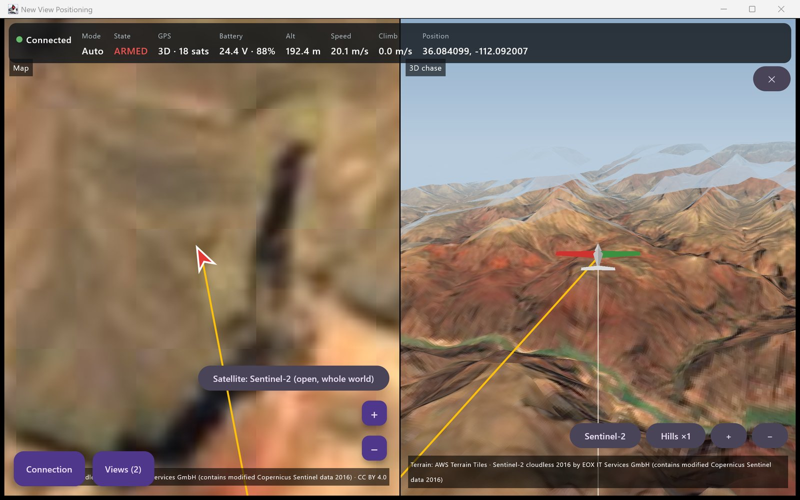
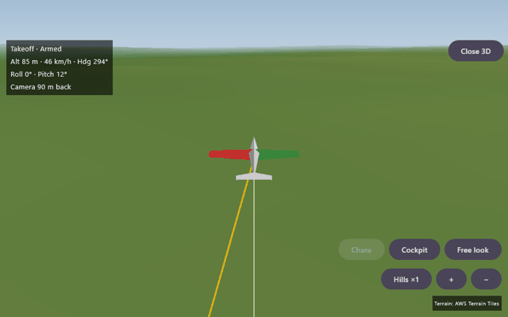
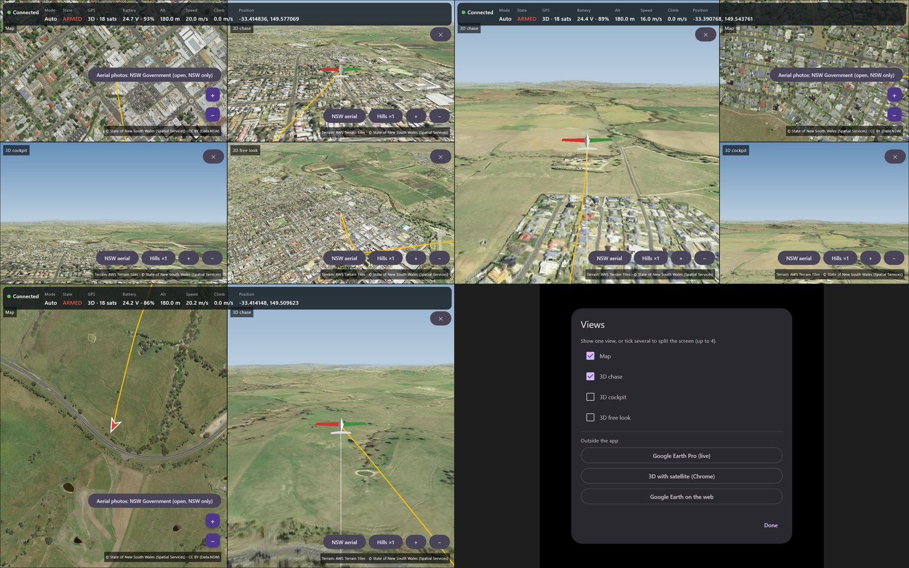
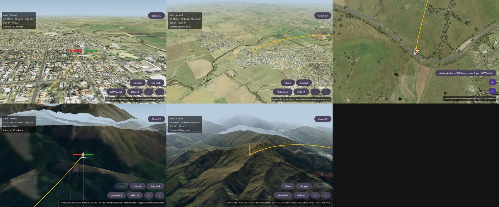
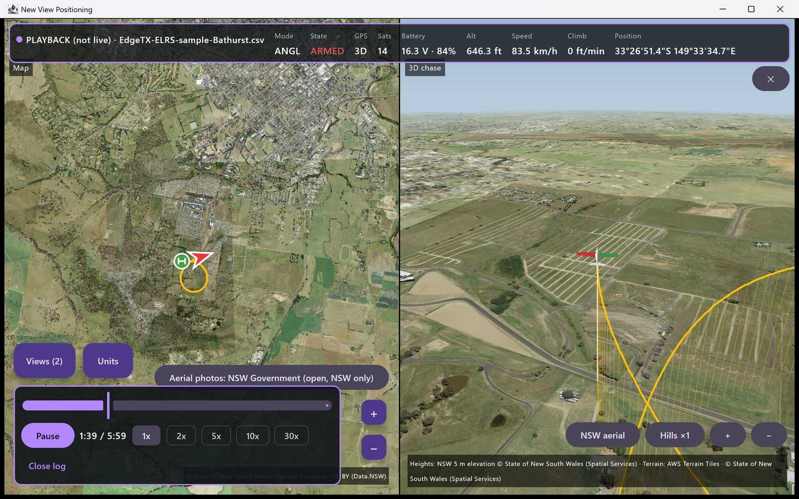
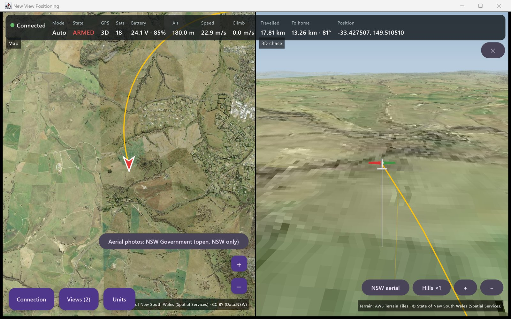
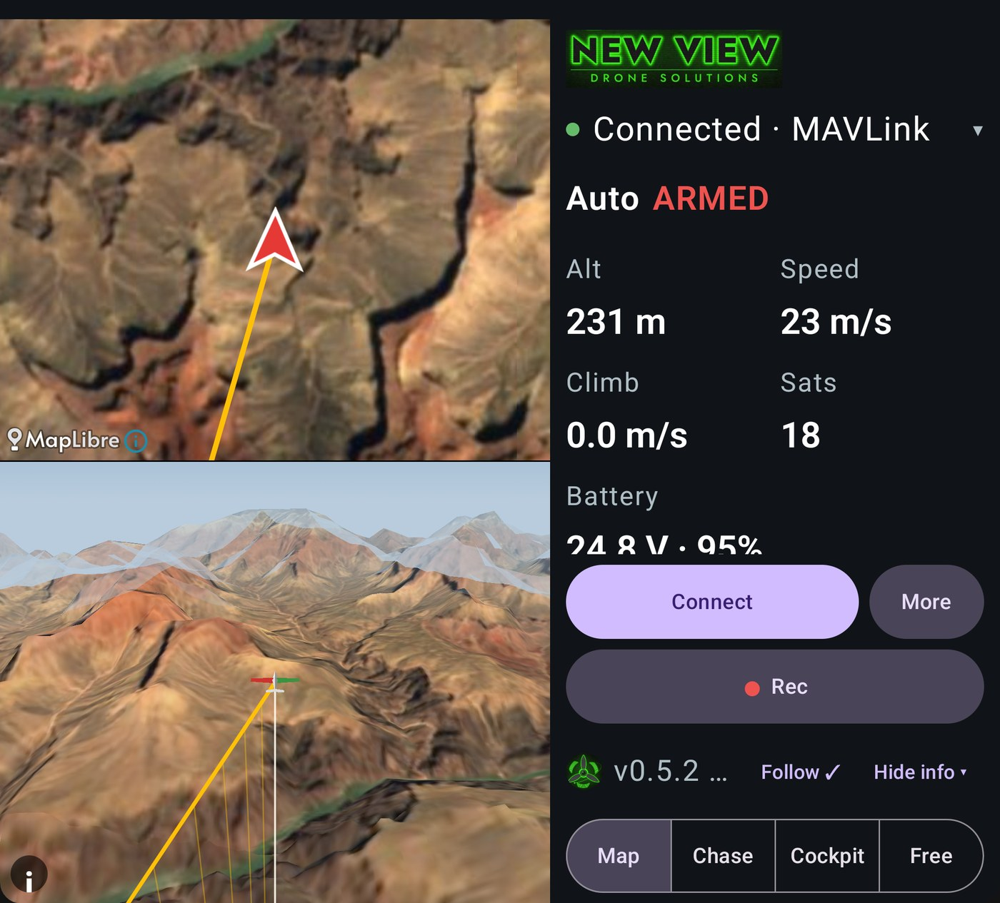
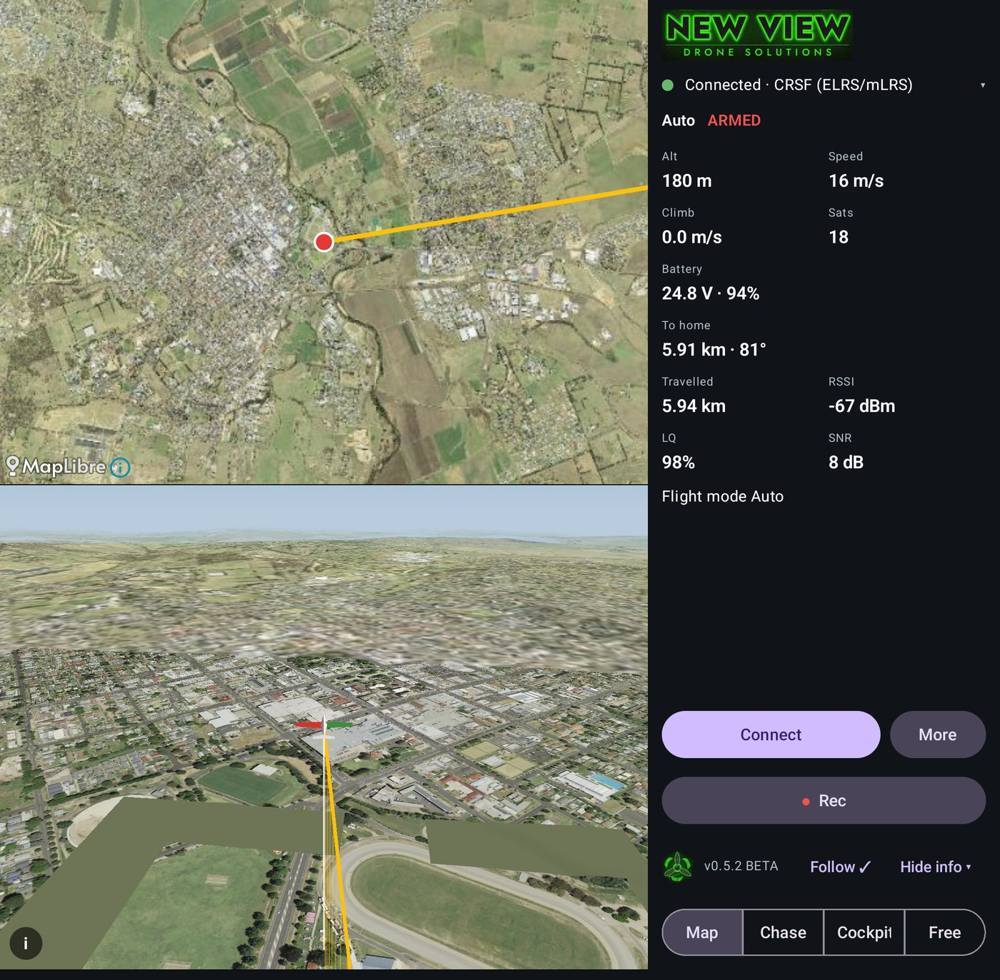
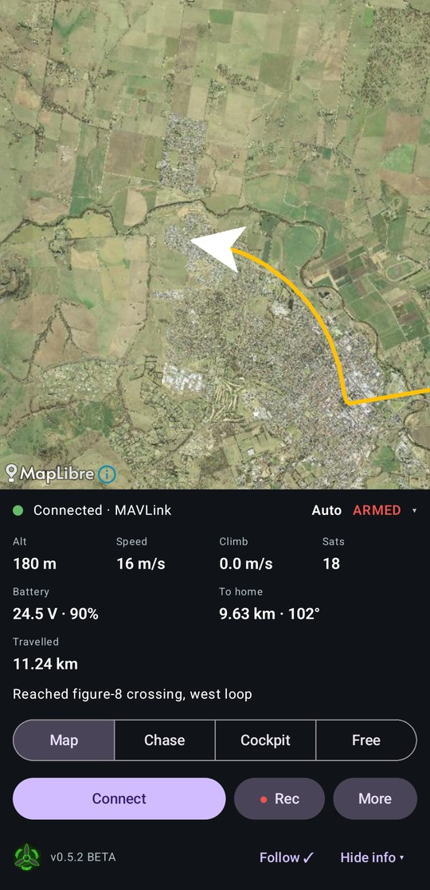
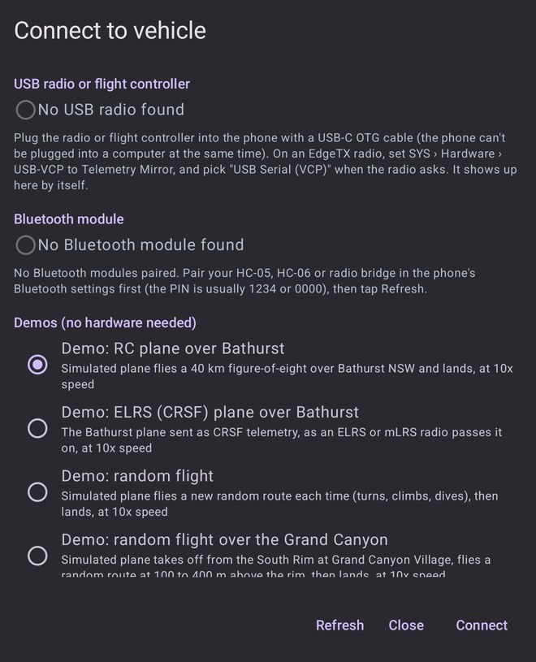

# New View Positioning

**See where your drone or RC plane is, live, on a map and in 3D.**

New View Positioning is a ground control app for MAVLink aircraft (ArduPilot and PX4) from New View Drone Solutions. It shows the aircraft's live position, heading, flight path and home point on a satellite map, next to a 3D view of the aircraft flying over the real terrain, with the numbers that matter across the top: flight mode, armed state, GPS, battery, altitude, speed, climb, distance travelled and distance to home.

It runs on Windows (portable zip, no install needed), and an **Android beta for testers** is out now: it also reads live **ELRS / CRSF** telemetry straight from an EdgeTX radio. macOS and Linux builds come from the same Kotlin codebase and are on the way.

**New View Positioning is free, and it stays free.** If it helps you, the best way to say thanks is to follow NewView FPV: [Instagram](https://www.instagram.com/newviewfpv), [YouTube](https://www.youtube.com/@NewViewFPV), [Facebook](https://www.facebook.com/NewViewFPV/) and [newviewdronesolutions.com](https://www.newviewdronesolutions.com/). New apps, updates and flying videos land there first. The app shows these links once when it first opens (**Follow** brings them back); following is optional and nothing is locked.

## Download

Get the latest Windows build from the [Releases page](../../releases/latest):

- **`NewViewPositioning-Windows-portable-1.0.7.zip`**: no install. Unzip anywhere and run `NewViewPositioning\NewViewPositioning.exe`.

It includes everything it needs, so there's no Java to install. The app isn't code-signed yet, so Windows may show a SmartScreen warning: choose **More info › Run anyway**.

**Android beta:** `NewViewPositioning-0.5.3-beta.apk` is on the [android-v0.5.3-beta pre-release](../../releases/tag/android-v0.5.3-beta). See [Android beta](#android-beta) below.

## Try it in 30 seconds

No aircraft needed. Press **Connect** and pick one of the built-in demo flights:

- **Demo: RC plane over Bathurst**: a plane takes off from Bathurst Airport (NSW), flies a 40 km figure-of-eight over the city and Mount Panorama, comes back and lands (10x speed, about 5 minutes).
- **Demo: random flight**, **over the Grand Canyon**, or **over Anchorage, Alaska**: a new random route every time, with turns, climbs and dives.
- **Demo vehicle**: a simple drone circling a test field.

You can also start a demo straight from a shortcut, for example `NewViewPositioning.exe --demo=demo-bathurst`.

## Features

**Live map and telemetry**
- Satellite map with the aircraft arrow, its flight path and the home marker. **Follow vehicle** keeps it centred.
- Top bar: connection, flight mode, armed state, GPS fix and satellites, battery voltage and percent, altitude, speed, climb rate, distance travelled, distance and bearing to home, and position.
- **Units**: metres or feet; m/s, km/h, mph or knots; altitude above home or above sea level; decimal degrees, degrees and minutes, or degrees, minutes and seconds. Your choice is remembered.
- Positions without a GPS fix are ignored, so bench sessions don't draw lines off to 0,0.

**3D view, built in**
- The aircraft flying over real terrain, with its 3D trail. Cameras: **chase**, **cockpit** and **free look** (drag to orbit, scroll to zoom).
- **Hills ×1/×2/×3** to exaggerate the terrain.
- In NSW it uses the NSW Government's 5 m elevation data and aerial photos for close-up detail.

**Views and split screen**
- **Views** shows the map, 3D chase, 3D cockpit and 3D free look on their own or side by side, up to four at once.
- Outside the app: a **Google Earth Pro live link** that makes Earth Pro follow the aircraft with a 3D model and its flight path, **3D with satellite** in Chrome, and **Google Earth on the web**.

**Flight log playback**
- **Play log** replays a MAVLink telemetry log (`.tlog`, as saved by Mission Planner, QGroundControl and MAVProxy) or an **EdgeTX/OpenTX radio SD-card log** (`.csv`, for example from an ELRS or Crossfire receiver) on the map, top bar and 3D view.
- Play/Pause, drag to any point, speed **1x to 30x**.
- A replay can't be mistaken for a live aircraft: the top bar turns purple and reads **PLAYBACK (not live)**, and nothing is ever sent to a radio.

**Connections**
- USB telemetry radios (SiK, RFD900) or a flight controller's own USB port, at 57600, 115200 or 921600 baud.
- **Bluetooth Classic** serial modules (HC-05, HC-06 and similar). On Windows a paired module shows up as a serial port marked "Bluetooth".
- **UDP port 14550** for ArduPilot SITL, MAVProxy or a network bridge.
- New in 1.0.7: **ELRS / CRSF** telemetry is recognised by itself on a serial link, for example an EdgeTX radio's USB port set to Telemetry Mirror (the same code as the Android beta; not yet tried with a radio on Windows).
- Once the autopilot's heartbeat arrives, the app sends its own 1 Hz heartbeat and asks for position, attitude, speeds, battery, GPS and home.

**Google Earth export**
- **Export flight for Google Earth…** saves the 3D flight path with a pin each minute, in plain KML.
- **Export flight replay for Google Earth Pro…** saves a time-stamped track that Earth Pro plays back with heading, pitch and roll.

**Free maps by default**
- Open imagery with no key, account or bill: NSW Government aerial photos (CC BY, NSW and ACT) and Sentinel-2 cloudless 2016 (CC BY 4.0) for the rest of the world, with AWS Terrain Tiles for the hills. Esri and OpenStreetMap are available too.
- Google satellite, road and terrain maps are optional, using a key each user adds themselves, with a built-in cap of 1,000 tiles a day. Set a daily quota on your Google key so it can never cost you anything.
- Tiles you've viewed are cached, so places you've flown before still show offline.

## Android beta

**New View Positioning for Android 0.5.3 beta** is a tester build: it isn't on Google Play yet. Plug your EdgeTX radio into your phone and see your aircraft live on the map and in 3D.

- **Live telemetry: CRSF and MAVLink.** ExpressLRS (ELRS), or mLRS in CRSF mode, through an EdgeTX radio set to Telemetry Mirror; and MAVLink from mLRS, SiK/RFD radios or a flight controller's USB port. The app works out which one a link carries by itself and shows it, for example **Connected · CRSF (ELRS/mLRS)**; **More › Telemetry protocol** can set it.
- **USB:** on the radio set **SYS › Hardware › USB-VCP** to **Telemetry Mirror**, connect with a USB-C OTG cable, choose **USB Serial (VCP)**, then connect at **115200** in the app.
- **Bluetooth:** an HC-05 or HC-06 on one of the radio's AUX serial ports set to Telemetry Mirror. With a CRSF module EdgeTX sends the mirror at **115200 baud**, so set the module to 115200 (they usually come set to 9600). Bluetooth Classic only, not BLE.
- Map with Follow, flight path and home; **Chase**, **Cockpit** and **Free** 3D views over real terrain; RSSI, link quality, SNR and TX power on CRSF links; screen recording to your gallery; built-in demo flights, including an ELRS (CRSF) demo.
- **Built for foldables:** folded, the view sits above the panel; unfolded, the map and a 3D view show side by side.

| Folded | Connect: USB, Bluetooth and demos |
|---|---|
|  |  |

**Installing:** Android 8.0 or newer (10 or newer recommended), with mobile data or Wi-Fi for the maps. Download the APK from the pre-release and tap it in **Files**; allow installs from that source when asked. If Google Play Protect says the app is blocked, tap **More details › Install anyway**. 0.5.3 installs over 0.5.0, 0.5.1 and 0.5.2 and keeps your settings; if you have an older New View test build (0.4.x), uninstall it first. The SHA-256 of the APK is listed with the release.

**Feedback:** **More › Send feedback** in the app, or email info@newviewdronesolutions.com with your phone model, Android version, radio and link, and screenshots or a screen recording.

## Safety

New View Positioning is a **situational-awareness aid only**. It isn't a navigation instrument and doesn't replace keeping your aircraft in **visual line of sight**. Always follow your local drone rules (for example CASA's in Australia). Telemetry can be delayed, wrong or lost, and map imagery can be out of date.

## Status

v1.0.7 is an early release. Here's what has and hasn't been checked so far:

| Area | Status |
|---|---|
| Windows desktop app (portable zip) | Built and run on Windows 11. The automated test suite passed for this build. |
| Demo flights, map, 3D view, Views split screen, Units, distance readouts | Checked through automated runs and screenshots of the demo flights. Not yet clicked through by hand. |
| `.tlog` playback | Checked with a recorded Bathurst demo flight and with Mission Planner bench logs. |
| EdgeTX/OpenTX `.csv` playback | Built to the EdgeTX log format and checked with a simulated log only. Not yet tried with a log from a real radio. |
| Live connection to a real aircraft | Not flight-tested yet. MAVLink handling is covered by tests and checked against pymavlink. |
| Bluetooth Classic | Written and type-checked, not yet tried with a real module. |
| Google Earth Pro live link | Covered by tests; the upgraded live link (3D model, chase camera) hasn't been checked on screen yet. |
| Android phone app | **0.5.3 beta for testers.** Live CRSF over USB and Bluetooth (HC-05/06) checked on a real EdgeTX radio, and the app checked on a Pixel 10 Pro Fold. The automated test suite passes. Not on Google Play yet. |
| macOS and Linux | Not released yet. |
| Map licences | The default maps are open data (CC BY). Esri imagery is optional, and Esri's terms want an ArcGIS account for released apps. |

## Roadmap

1. BLE (Nordic UART) link
2. HUD with an attitude indicator, plus a vehicle messages list
3. Flight controller DataFlash log (`.bin`) playback
4. Android release on Google Play (in beta testing now)
5. Parameters, then mission planning with waypoints on the map
6. Offline maps on the phone

## How it's built

Kotlin with [Compose Multiplatform](https://www.jetbrains.com/compose-multiplatform/), so the phone and desktop share one UI and one telemetry engine. The MAVLink parser and encoder are our own, with no GPL code from Mission Planner or QGroundControl. The 3D view is drawn by the app itself, so no browser or 3D engine is needed. Serial ports use [jSerialComm](https://fazecast.github.io/jSerialComm/) on desktop and [usb-serial-for-android](https://github.com/mik3y/usb-serial-for-android) on Android; the Android map uses [MapLibre](https://maplibre.org/).

Map data © State of New South Wales (Spatial Services); Sentinel-2 cloudless 2016 by EOX IT Services GmbH (contains modified Copernicus Sentinel data 2016); AWS Terrain Tiles; © OpenStreetMap contributors; Esri. Credits are shown on the map in the app.

## Contact

**NewView FPV** by New View Drone Solutions

- Email: info@newviewdronesolutions.com
- Website: https://www.newviewdronesolutions.com/
- Instagram: https://www.instagram.com/newviewfpv
- YouTube: https://www.youtube.com/@NewViewFPV
- Facebook: https://www.facebook.com/NewViewFPV/
- Discord: bigredfpv

© 2026 New View Drone Solutions. All rights reserved.
